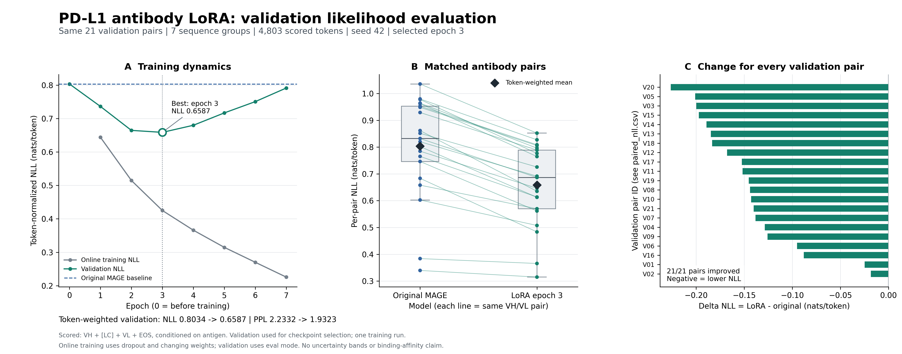

# PDL1_Antibodygenerator_project

PD-L1 항체 생성 프로젝트. 원본 **MAGE**를 실측 양성 항체 106쌍으로 **LoRA 미세조정**하고, 동일한 검증 항체쌍의 조건부 NLL을 비교한다.

## 먼저 볼 파일

- [MAGE.py](항체실험/MAGE.py): 원본 MAGE 로딩·PD-L1 항체 생성·NLL 평가.
- [LoRA.py](항체실험/LoRA.py): 데이터 분할·LoRA 학습·학습된 모델 생성·NLL 평가·시각화.
- [시작안내](항체실험/시작안내.md): 설정과 명령 설명.

각 파일 맨 위에서 경로와 설정을 확인할 수 있다. 기본 실행은 PD-L1 항체 한 쌍 생성이며, 새 학습은 `--mode train`을 명시할 때만 진행한다.

## 저장소에 포함한 자료

- 선별한 PD-L1 항원–VH/VL 106쌍 CSV.
- 유사도 그룹을 유지한 고정 학습 85쌍 / 검증 21쌍과 split manifest.
- 최적 LoRA 어댑터(약 8MB), epoch별 로그, 환경·시드·해시 기록.
- 검증 서열별 NLL, 학습 곡선, 전후 비교 그림, 테스트 코드.

가상환경·캐시·대용량 원본 모델·임시 생성 결과는 Git에 포함하지 않는다. 원본 MAGE 가중치와 ProGen 소스는 아래처럼 준비한다.

## 처음 실행하는 조원: Windows / Python 3.11

프로젝트를 받은 뒤 **저장소 루트의 PowerShell**에서 실행한다. 아래는 현재 실험의 NVIDIA CUDA 환경을 기준으로 한다. 학습·모델 평가는 CUDA BF16 지원 GPU가 필요하고, 기존 지표의 요약·시각화에는 GPU가 필요 없다.

```powershell
git clone https://github.com/sanghyeb2/PDL1_Antibodygenerator_project.git
cd PDL1_Antibodygenerator_project

# 원본 코드와 같은 위치에 가상환경 생성
py -3.11 -m venv MAGE_ab_generation/.venv-mage-gpu
$magePython = Join-Path (Get-Location) 'MAGE_ab_generation/.venv-mage-gpu/Scripts/python.exe'
& $magePython -m pip install torch==2.7.1 --index-url https://download.pytorch.org/whl/cu128
& $magePython -m pip install -r 항체실험/requirements-lock.txt

# MAGE의 기반 모델 구현을 검증한 commit으로 고정
git clone https://github.com/enijkamp/progen2.git 항체실험/외부코드/progen2
git -C 항체실험/외부코드/progen2 checkout 9b4d4fb5ec19c9e55c4bb06305c0e613e46c1cf5

# 공개 원본 MAGE 가중치 다운로드: 약 3GB, 최초 한 번
& $magePython -c "from huggingface_hub import snapshot_download; snapshot_download(repo_id='perrywasdin/MAGE_V1', revision='dad1a221e992771666ba9d36b59de5bbe7015321', local_dir='MAGE_ab_generation', allow_patterns=['LICENSE','model_epoch4/*.json','model_epoch4/pytorch_model.bin'])"

# 준비 상태 확인
& $magePython -X utf8 항체실험/MAGE.py --mode check
& $magePython -X utf8 항체실험/LoRA.py --mode check
```

원본 가중치의 기대 SHA-256은 `4275d6b075c5cb307e8d4ba18408aef3bc8f4b107dfc170085d5bb76087609fe`이다. 다른 모델 파일을 쓰면 동일 실험이라고 간주하지 않는다. 다운로드한 파일은 다음 명령으로 확인한다.

```powershell
Get-FileHash MAGE_ab_generation/model_epoch4/pytorch_model.bin -Algorithm SHA256
```

## 평소 실행

```powershell
# 기본 Python으로 호출해도 위 가상환경을 자동 선택
python 항체실험/MAGE.py
python 항체실험/LoRA.py

# 기존 결과 요약·시각화 (모델 추론이나 재학습 없음)
python 항체실험/LoRA.py --mode summary
python 항체실험/LoRA.py --mode plot --show

# 동일 검증셋의 NLL 측정
python 항체실험/MAGE.py --mode evaluate
python 항체실험/LoRA.py --mode evaluate

# 새 실험: 날짜별 새 결과 폴더 생성
python 항체실험/LoRA.py --mode train
```

## 현재 실험 결과

- split seed / training seed: 각각 **42**.
- VH 또는 VL의 정규화 편집거리 유사도 90% 이상이면 같은 연결 그룹에 배치.
- 학습 85쌍 / 검증 21쌍, 양쪽 사이 기준 위반 0건.
- rank 8, alpha 16, dropout 0.05, lr 1e-4, gradient accumulation 8.
- 7 epoch에서 조기 종료. 선택된 checkpoint는 **epoch 3**.
- 검증 token-weighted NLL: **0.803423 → 0.658714**.
- 검증 perplexity: **2.233172 → 1.932305**.



최적 가중치는 [최적어댑터](항체실험/학습결과/본학습_20261108_시드42/최적어댑터)에 있다. 어댑터만으로 전체 모델이 되지는 않으며, 코드가 로컬 원본 MAGE를 먼저 불러와 연결한다.

과거 설정 파일의 절대 경로와 소스 hash는 실행 당시 기록이다. 현재 코드 위치와 다른 것이 정상이며, 현재 실행에는 위 명령을 사용한다. 같은 분할과 시드를 유지하더라도 다른 GPU·라이브러리 버전에서 bit 단위 수치 일치까지 보장하지 않는다.

검증셋은 checkpoint 선택에도 사용했다. 따라서 독립 test 성능, 실제 PD-L1 결합력이나 개발 가능성을 입증하는 결과는 아니다.

## 협업

작업 전 `git pull`, 작업 후 변경을 확인해 커밋·푸시한다. 생성 결과·환경 폴더는 `.gitignore`로 제외된다. 새로운 최적 어댑터를 공유할 때는 데이터 분할·시드·설정·평가 결과도 함께 기록한다.

```powershell
git pull
git status
git add 항체실험/MAGE.py 항체실험/LoRA.py
git commit -m "Describe the change"
git push
```

테스트:

```powershell
& MAGE_ab_generation/.venv-mage-gpu/Scripts/python.exe -X utf8 -m unittest discover -s 항체실험/검사 -p 'test_*.py' -v
```

## 원본 자료와 권리

- [MAGE 코드](https://github.com/IGlab-VUMC/MAGE_ab_generation), [MAGE 원본 모델](https://huggingface.co/perrywasdin/MAGE_V1), [MAGE 논문](https://doi.org/10.1016/j.cell.2025.10.006).
- [ProGen2 코드](https://github.com/enijkamp/progen2): BSD 3-Clause. 별도로 내려받는 원본 라이선스를 따른다.
- 데이터 CSV의 `source_url`·`binding_evidence_url` 등의 출처를 보존했다. 데이터와 원본 모델의 사용·재배포 조건은 각각의 원 출처를 따른다.

이 저장소를 공개했다고 해서 외부 데이터·모델에 새로운 사용 허가가 부여되는 것은 아니다.
