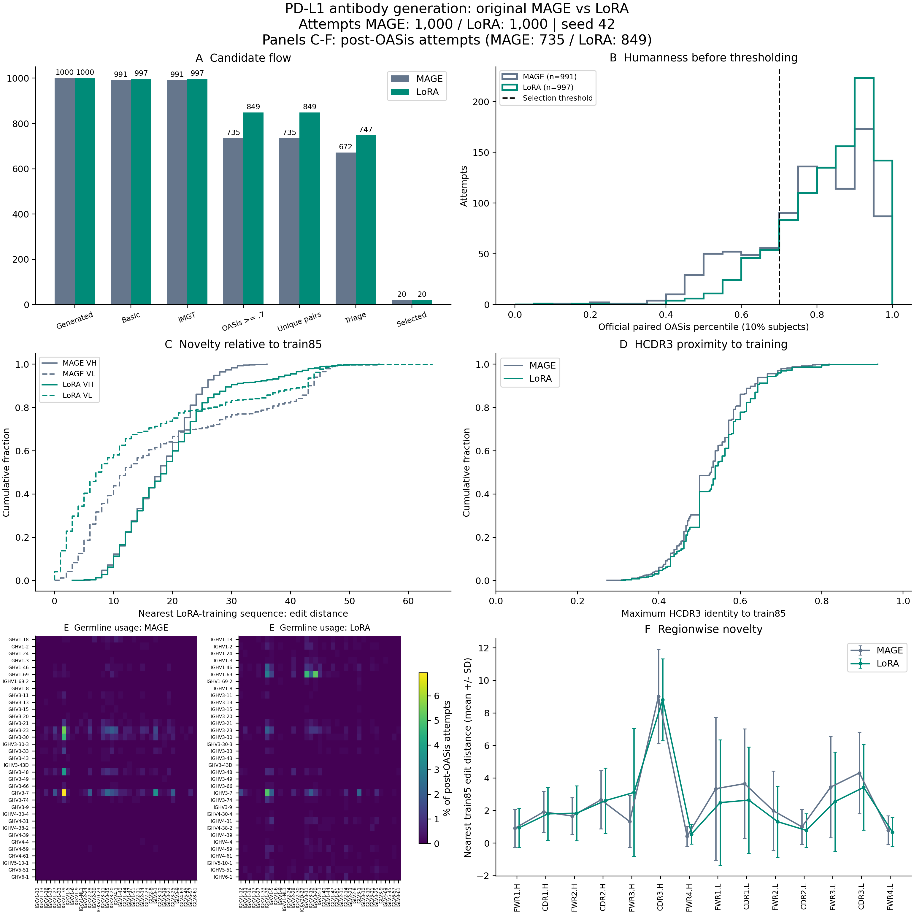
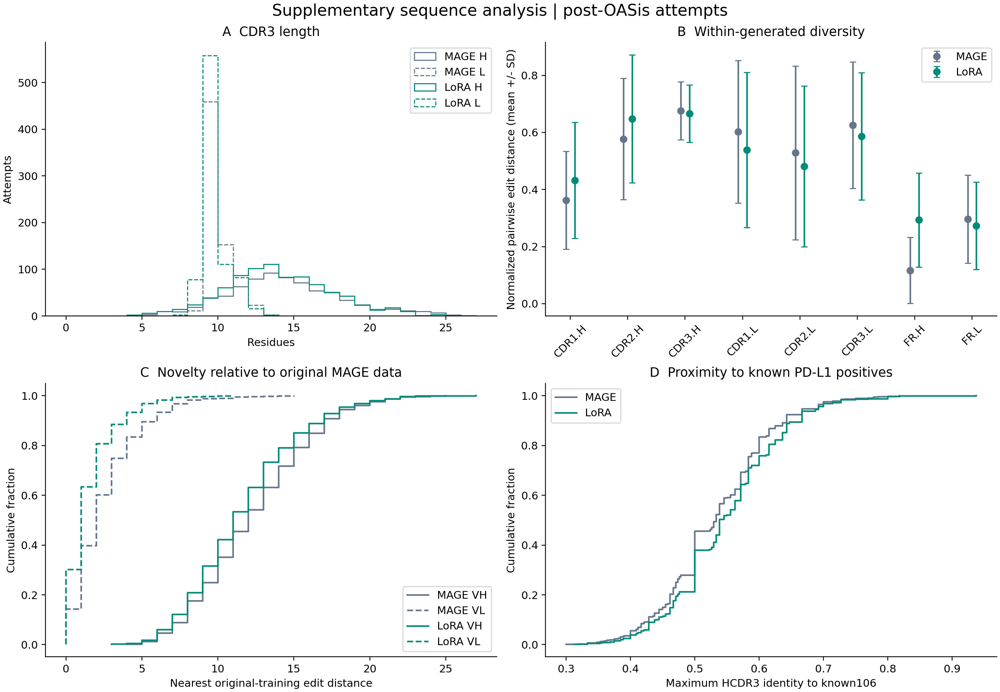
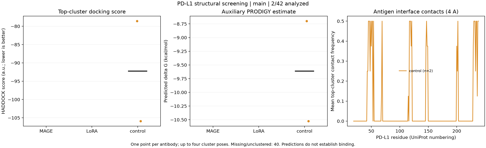
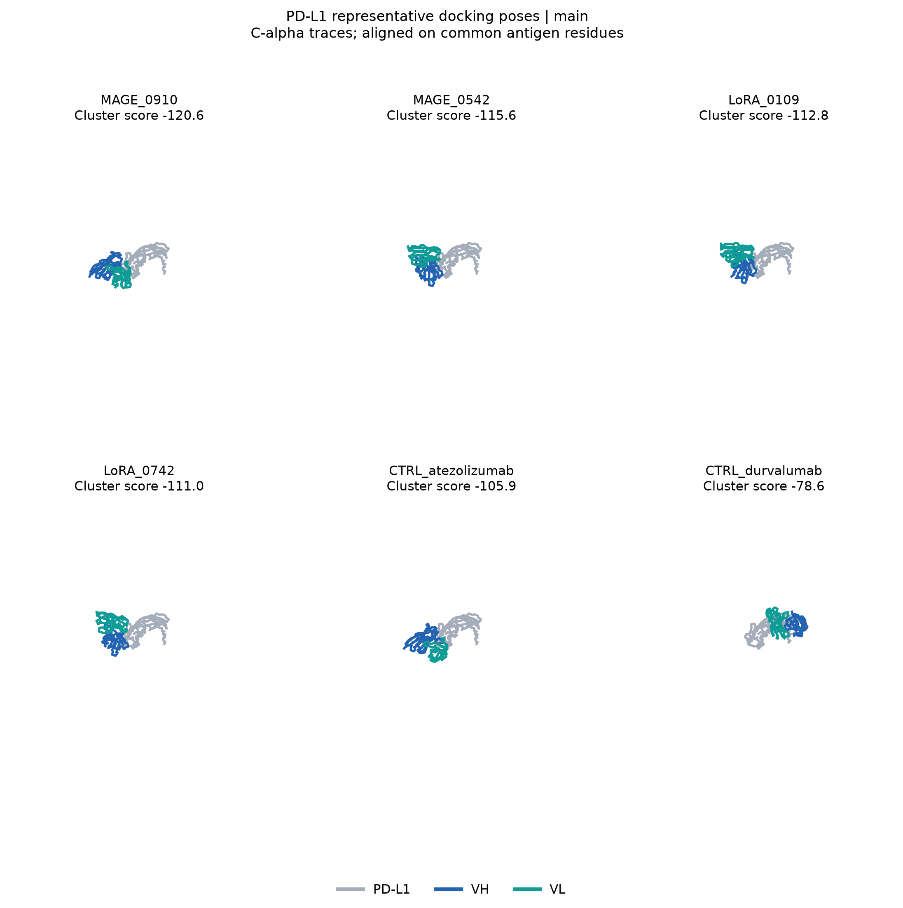
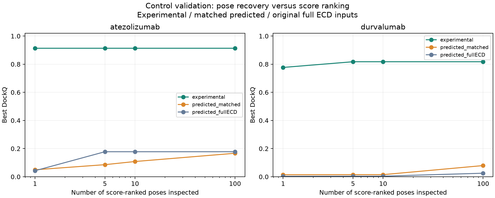

# PDL1_Antibodygenerator_project

PD-L1 항체 생성 프로젝트. 실측 양성 항체 106쌍을 학습 85쌍·검증 21쌍으로 나누어 원본 **MAGE**를 **LoRA 미세조정**하고, 검증 NLL과 생성 항체의 서열 특성을 비교한다.

## 조원이 먼저 확인할 진행 상황 — 2026-11-20

**`main`**에 LoRA 실험 코드와 최종 생성·분석 결과를 모았다. 실험 진행 이력의 브랜치 이름은 **`MAGE_ROLA`**이고, 모델 기법 이름은 **LoRA**다.

- **완료:** 양성 데이터 106쌍 선별 → 유사도 그룹 분할 → LoRA 학습 → 검증 NLL 비교 → 두 모델에서 각각 1,000회 생성 → ANARCI/OASis 서열 분석 → 각각 20쌍 후보 선별 → 결과 시각화.
- **구조 평가 완료:** 원본 MAGE 20쌍 + LoRA 20쌍 + atezolizumab/durvalumab 대조군 2쌍의 HADDOCK3 도킹·클러스터·접촉면 분석·PRODIGY 보조 평가를 완료했다. 결과 순위는 계산 점수에 따른 탐색용 순위이며 실험적으로 검증된 결합력 순위가 아니다. [구조 평가 설정](항체실험/구조평가_환경/README.md).
- **11월 15일 재개:** 이전 Colab 임시 디스크가 초기화되어 내려받지 못한 공통 항원 결과는 소실됨을 확인했다. 입력·MSA·시드 42는 로컬에 보존되어 있다. Fv 배치의 `--recompile-padding 1.1`은 설치 버전에서 정수를 요구하므로 `10`으로 수정했다. 공통 항원 완료 직후 별도 ZIP을 내보내도록 보완했다. 구조 예측 재개와 전체 도킹 완료는 구분해서 기록한다.
- **구조 예측 완료:** 공통 PD-L1과 Fv 42쌍, **전체 구조 43/43**을 Colab ZIP으로 내려받아 입력/설정 검사를 통과하고 로컬에 저장했다. [Fv 구조 신뢰도 요약](항체실험/공유결과/구조평가_20261115/folding_summary.json)은 PD-L1 결합력 지표가 아니다.
- **본 도킹·분석 42/42 완료 (11월 19일):** MAGE 20개 + LoRA 20개 + 대조군 2개, 분석 제외 0개. 마지막 도킹은 06:12 KST 완료됐고 계산은 종료됐다. 후보별 지표·대표 포즈·요약표·그래프를 공유 폴더에 반영했다. 병렬 6개·시드 42·1,000/100 예산 유지. 두 대조군의 알려진 접촉 복원율이 낮아 점수만으로 올바른 결합이나 LoRA 우수성을 단정할 수 없다. [전체 결과](항체실험/공유결과/구조평가_20261115/README.md), [완료 상태](항체실험/공유결과/구조평가_20261115/status_snapshot.json), [실행 기록](항체실험/구조평가_환경/재개안내.md).
- **추가 대조군 검증 완료 (11월 20일 02:49 KST):** 두 대조군의 실험 구조/잔기 범위 일치 ColabFold 입력 4조건 재도킹과 기존 전체 ECD 조건을 포함한 6조건·600포즈 품질 평가 완료. 실험 구조의 최상 DockQ는 0.913/0.817, 예측 구조의 최상은 0.167/0.079이다. 실험 atezolizumab의 점수 1위 고품질 포즈가 미분류로 최종 클러스터 선택에서 제외된 것을 확인했다. 기존 main 42쌍은 보존했다. [검증 결과·그래프](항체실험/공유결과/대조군검증_20261119/README.md), [후속 계획](항체실험/구조평가_환경/대조군검증_후속계획.md). 후속 계산은 아직 시작하지 않았다.
- **선정·입력 점검 1·2단계 완료 (11월 20일):** 기존 600포즈를 재사용해 동일 후보 수의 선정 규칙을 비교하고 CDR/상대 배치·AIR·전처리 화학 차이를 점검했다. atezolizumab 실험 입력은 같은 4개 예산에서 기존 클러스터 기준 최상 DockQ0.0206 대 전체 점수/구제 기준0.9128이었다. 예측 입력의 낮은 품질은 선정 변경만으로 해결되지 않았으며, 두 히스티딘의 입력별 양성자화/전하 차이도 확인했다. 새 도킹은 하지 않았다. [결과·그래프·구조 중첩](항체실험/공유결과/대조군점검_20261120/README.md).
- **비교 조건 통일·전처리 확인 완료 (11월 20일):** 두 대조군의 실험/예측 Fv 쌍마다 같은 관측 서열·실험 PD-L1·AIR·중성 HISE 정책을 적용하고 실제 PSF의 양성자화·전하·결합 연결 일치를 확인했다. atezolizumab의 cis/trans 및 C/CCIS 타입 차이와 입력별 Fv 내부 유지 거리 제약은 구조 변수로 보존·명시했다. 모든 force-field 파라미터가 같은 순수 좌표 비교는 아니다. 새 전체 도킹은 아직 시작하지 않았다. [고정 입력·검사 결과](항체실험/공유결과/비교조건통일_20261120/README.md).
- **후속 검증:** 서열·도킹 제약·양성자화 조건을 통제한 대조군 교차 실험과 실제 PD-L1 결합력 확인. 교차 도킹은 아직 시작하지 않았다.
- **결과를 바로 보려면:** 아래 두 실험 그림과 [공유 결과 폴더](항체실험/공유결과/PDL1_MAGE_LoRA_20261114/README.md)를 확인한다. 그림·FASTA·CSV 열람에는 모델이나 OASis DB 설치가 필요 없다.

## 먼저 볼 파일

- [MAGE.py](항체실험/MAGE.py): 원본 MAGE 로딩·PD-L1 항체 생성·NLL 평가.
- [LoRA.py](항체실험/LoRA.py): 데이터 분할·LoRA 학습·학습된 모델 생성·NLL 평가·시각화.
- [구조평가.py](항체실험/구조평가.py): 선별 후보·대조군 준비, ColabFold, HADDOCK3, 접촉면·PRODIGY 분석. Linux/WSL의 별도 구조 환경을 사용한다.
- [시작안내](항체실험/시작안내.md): 설정과 명령 설명.

각 파일 맨 위에서 경로와 설정을 확인할 수 있다. 기본 실행은 PD-L1 항체 한 쌍 생성이며, 새 학습은 `--mode train`을 명시할 때만 진행한다.

## 저장소에 포함한 자료

- 선별한 PD-L1 항원–VH/VL 106쌍 CSV.
- 유사도 그룹을 유지한 고정 학습 85쌍 / 검증 21쌍과 split manifest.
- 최적 LoRA 어댑터(약 8MB), epoch별 로그, 환경·시드·해시 기록.
- 검증 서열별 NLL, 학습 곡선, 전후 비교 그림, 테스트 코드.
- 원본/LoRA 각 1,000회 생성 원시 출력, 모든 시도의 분석 지표, 최종 후보 각 20쌍, 생성 분석 PNG/SVG와 실행 설정.

가상환경·캐시·대용량 원본 모델·임시 생성 결과는 Git에 포함하지 않는다. 완료된 결과만 `항체실험/공유결과`에 별도로 공유한다. 원본 MAGE 가중치와 ProGen 소스는 아래처럼 준비한다.

## 처음 실행하는 조원: Windows / Python 3.11

프로젝트를 받은 뒤 **저장소 루트의 PowerShell**에서 실행한다. 아래는 현재 실험의 NVIDIA CUDA 환경을 기준으로 한다. 학습·모델 평가는 CUDA BF16 지원 GPU가 필요하고, 기존 지표의 요약·시각화에는 GPU가 필요 없다.

```powershell
git clone --branch main https://github.com/sanghyeb2/PDL1_Antibodygenerator_project.git
cd PDL1_Antibodygenerator_project

# 원본 코드와 같은 위치에 가상환경 생성
py -3.11 -m venv MAGE_ab_generation/.venv-mage-gpu
$magePython = Join-Path (Get-Location) 'MAGE_ab_generation/.venv-mage-gpu/Scripts/python.exe'
& $magePython -m pip install torch==2.7.1 --index-url https://download.pytorch.org/whl/cu128
& $magePython -m pip install -r 항체실험/requirements-lock.txt

# MAGE의 기반 모델 구현을 검증한 commit으로 고정
git clone https://github.com/enijkamp/progen2.git 항체실험/외부코드/progen2
git -C 항체실험/외부코드/progen2 checkout 9b4d4fb5ec19c9e55c4bb06305c0e613e46c1cf5

# 공개 원본 MAGE 가중치 다운로드: 약 3GB, 최초 한 번
& $magePython -c "from huggingface_hub import snapshot_download; snapshot_download(repo_id='perrywasdin/MAGE_V1', revision='dad1a221e992771666ba9d36b59de5bbe7015321', local_dir='MAGE_ab_generation', allow_patterns=['LICENSE','model_epoch4/*.json','model_epoch4/pytorch_model.bin'])"

# 준비 상태 확인
& $magePython -X utf8 항체실험/MAGE.py --mode check
& $magePython -X utf8 항체실험/LoRA.py --mode check
```

원본 가중치의 기대 SHA-256은 `4275d6b075c5cb307e8d4ba18408aef3bc8f4b107dfc170085d5bb76087609fe`이다. 다른 모델 파일을 쓰면 동일 실험이라고 간주하지 않는다. 다운로드한 파일은 다음 명령으로 확인한다.

```powershell
Get-FileHash MAGE_ab_generation/model_epoch4/pytorch_model.bin -Algorithm SHA256
```

## 평소 실행

```powershell
# 기본 Python으로 호출해도 위 가상환경을 자동 선택
python 항체실험/MAGE.py
python 항체실험/LoRA.py

# 기존 결과 요약·시각화 (모델 추론이나 재학습 없음)
python 항체실험/LoRA.py --mode summary
python 항체실험/LoRA.py --mode plot --show

# 동일 검증셋의 NLL 측정
python 항체실험/MAGE.py --mode evaluate
python 항체실험/LoRA.py --mode evaluate

# 새 실험: 날짜별 새 결과 폴더 생성
python 항체실험/LoRA.py --mode train
```

## 실험 1. LoRA 학습과 검증 NLL 변화

- split seed / training seed: 각각 **42**.
- VH 또는 VL의 정규화 편집거리 유사도 90% 이상이면 같은 연결 그룹에 배치.
- 학습 85쌍 / 검증 21쌍, 양쪽 사이 기준 위반 0건.
- rank 8, alpha 16, dropout 0.05, lr 1e-4, gradient accumulation 8.
- 7 epoch에서 조기 종료. 선택된 checkpoint는 **epoch 3**.
- 검증 token-weighted NLL: **0.803423 → 0.658714**.
- 검증 perplexity: **2.233172 → 1.932305**.


**그림 1. 표본과 분포.** A는 학습 85쌍과 고정 검증 21쌍의 epoch별 NLL이다. B의 연결선 하나는 같은 검증 항체의 원본 MAGE와 LoRA NLL이며, 상자는 쌍별 NLL의 가운데 50%, 검은 마름모는 전체 4,803개 토큰의 가중 평균이다. C는 검증 21쌍(7개 유사도 그룹)의 쌍별 NLL 변화이며, 21쌍 모두 감소했다.

최적 가중치는 [최적어댑터](항체실험/학습결과/본학습_20261108_시드42/최적어댑터)에 있다. 어댑터만으로 전체 모델이 되지는 않으며, 코드가 로컬 원본 MAGE를 먼저 불러와 연결한다.

과거 설정 파일의 절대 경로와 소스 hash는 실행 당시 기록이다. 현재 코드 위치와 다른 것이 정상이며, 현재 실행에는 위 명령을 사용한다. 같은 분할과 시드를 유지하더라도 다른 GPU·라이브러리 버전에서 bit 단위 수치 일치까지 보장하지 않는다.

검증셋은 checkpoint 선택에도 사용했다. 따라서 독립 test 성능, 실제 PD-L1 결합력이나 개발 가능성을 입증하는 결과는 아니다.

## 실험 2. 2026-11-14 생성 항체 분석과 후보 선별

원본 MAGE와 최적 LoRA로 같은 PD-L1 세포외 도메인을 입력해 **각 1,000회** 생성했다. 이전 중간 저장 배치를 재사용해 완료했으며, 실패한 시도도 원시 토큰·서열·사유와 함께 보존했다. 성공한 서열만으로 1,000개를 채운 실험이 아니다.

- **공통 생성 조건:** seed 42, batch 4, top-p 0.9, temperature 1.0, 새 토큰 최대 250. 배치별 시드는 `42 + 배치 시작 인덱스`.
- **원본 MAGE:** 1,000회 → 기본 검사·IMGT 주석 **991쌍** → OASis 기준 **735쌍** → 추가 선별 **672쌍** → 최종 **20쌍**.
- **LoRA:** 1,000회 → 기본 검사·IMGT 주석 **997쌍** → OASis 기준 **849쌍** → 추가 선별 **747쌍** → 최종 **20쌍**.
- **OASis 통과율:** 전체 생성 1,000회 기준 **73.5% → 84.9%**, **11.4%p 증가**. 주석 통과 집단의 OASis 중앙값은 **0.8061 → 0.8597**.
- **중복·학습 서열 근접성:** OASis 통과 집단에서 동일 VH/VL 쌍 중복은 두 모델 모두 0건이고, train85와 완전히 같은 HCDR3도 0건이다. 이는 해당 참조와의 서열 비교 결과이며 새로운 결합 기능의 증거는 아니다.



**그림 2A. 표본과 분포.** 패널 A는 모델당 1,000회 생성 시도의 단계별 통과 수다. B는 IMGT 주석을 통과한 **MAGE 991쌍·LoRA 997쌍**의 OASis 백분위 히스토그램이며 점선은 선별 기준 0.70이다. C–F는 **OASis를 통과한 MAGE 735쌍·LoRA 849쌍**을 사용한다. C는 학습 85쌍 대비 전체 사슬 최소 편집거리의 누적분포, D는 HCDR3 최대 유사도의 누적분포, E는 VH·VL V 유전자 조합의 비율, F는 영역별 편집거리의 평균과 표준편차다. F는 VH와 VL 각각에서 가장 가까운 전체 사슬 참조를 먼저 고른 뒤, 그 참조의 각 영역과 비교한다.



**그림 2B. 표본과 분포.** OASis 통과 집단인 **MAGE 735쌍·LoRA 849쌍**의 CDR3 길이, 생성 집단 내부의 서열 거리, 원본 MAGE 학습 자료 18,507쌍 대비 거리, 알려진 PD-L1 양성 106쌍 대비 HCDR3 유사도를 보여준다. **train85**는 이번 LoRA 학습 자료이고 **known106**은 후보 선별에 사용한 양성 참조다. known106에는 검증 21쌍도 포함된다.

선별은 MAGE RBD 공개 절차를 PD-L1에 적용했다. ANARCI human/IMGT 주석에서 두 체인의 7개 영역과 100 aa 이상을 확인하고, 공식 BioPhi/OASis v1의 `min_fraction_subjects=0.10`, paired percentile ≥0.70을 적용했다. 이어 VH V-germline identity 0.85 이상 1 미만, 학습 참조와 동일 HCDR3 제외 후 **VH 유전자별 20/80% 위치 10개 + 알려진 양성 HCDR3 근접 5개 + VH 근접 5개**를 고르고 쌍 중복을 제거했다. 정확한 기준과 적용 차이는 [시작안내](항체실험/시작안내.md)에 기록했다.

- [LoRA 최종 후보 20쌍 FASTA](항체실험/공유결과/PDL1_MAGE_LoRA_20261114/분석/LoRA_최종후보.fasta) / [CSV](항체실험/공유결과/PDL1_MAGE_LoRA_20261114/분석/LoRA_최종후보.csv)
- [원본 MAGE 최종 후보 20쌍 FASTA](항체실험/공유결과/PDL1_MAGE_LoRA_20261114/분석/MAGE_최종후보.fasta) / [CSV](항체실험/공유결과/PDL1_MAGE_LoRA_20261114/분석/MAGE_최종후보.csv)
- [전체 2,000회 시도별 지표](항체실험/공유결과/PDL1_MAGE_LoRA_20261114/분석/전체후보_단계별지표.csv) / [그림 읽는 방법](항체실험/공유결과/PDL1_MAGE_LoRA_20261114/분석/결과_읽는법.md)
- [주요 그림 SVG](항체실험/공유결과/PDL1_MAGE_LoRA_20261114/분석/생성항체_주요분석.svg) / [보충 그림 SVG](항체실험/공유결과/PDL1_MAGE_LoRA_20261114/분석/생성항체_보충분석.svg)

이번 단일 시드 생성 비교에서 LoRA의 사람 항체 서열 유사성 지표가 높았다. 각 모델에서 선별한 20쌍을 실험 3의 구조 평가에 사용했다. 실제 결합과 면역원성은 별도 실험으로 평가해야 한다.

## 실험 3. 구조 예측과 도킹 최종 결과 — 2026-11-19 완료

원본 MAGE 20쌍 + LoRA 20쌍 + 양성 대조군 2쌍의 Fv 및 공통 PD-L1 ECD를 ColabFold로 예측해 **43/43개 구조**를 로컬에 보존했다. 구조 신뢰도는 [Fv별 pLDDT·VH–VL PAE 요약](항체실험/공유결과/구조평가_20261115/folding_summary.json)에서 확인한다. 이 지표는 PD-L1과의 결합력이 아니다.

**42/42쌍의 도킹·분석을 완료했다.** 분석에는 실험 2에서 선별한 MAGE 20쌍과 LoRA 20쌍, 양성 대조군 atezolizumab과 durvalumab이 포함된다.

- **동일 계산 조건:** 6개 병렬 작업, 기본 시드 42, rigidbody 1,000회 → 상위 100개 정제 → FCC 클러스터 → 접촉면·PRODIGY 분석. 일시정지와 재개 이력은 [실행 기록](항체실험/구조평가_환경/재개안내.md)에 있다.
- **첫 대조군의 처리 수:** 초기 1,000회 탐색에서 출력 **999개**가 공식 단계 출력에 포함됐고, 상위 100개 정제를 완료했다. 선택 클러스터는 7개 포즈이며, 상위 4개 HADDOCK 점수 평균 **−105.9005 a.u.**, 표준편차 **10.2124**다. 이 표준편차는 4개 계산 포즈 사이의 변동이며 독립 생물학적 반복의 오차가 아니다.
- **PRODIGY 보조 추정:** 상위 4개 포즈의 추정 ΔG 평균 **−10.525 kcal/mol**. 실측 친화도가 아니며 포즈에 의존한다.
- **두 번째 대조군 durvalumab:** 선택 클러스터 40개 포즈, 상위 4개 점수 평균 **−78.603 a.u.**, 포즈 표준편차 **4.0262**, PRODIGY 추정 ΔG 평균 **−8.7 kcal/mol**.
- **접촉면 복원의 한계:** 실험 구조의 항체–PD-L1 잔기 접촉(4 Å) 대비 recall은 atezolizumab 선택 포즈에서 **0%, 2.04%, 2.04%, 0%**, durvalumab에서는 **모두 0%**다. **알려진 접촉면을 충분히 재현하지 못했으므로, 낮은 도킹 점수나 유리한 추정 ΔG만으로 결합 포즈 복원 성공·생성 항체의 우수성을 주장할 수 없다.**



**그림 3A. 표본과 분포.** 세 패널 모두 **MAGE 20쌍·LoRA 20쌍·대조군 2쌍**을 포함한다. 왼쪽과 가운데는 항체당 점 하나로, 선택 클러스터에서 최대 4개 포즈를 평균했다. 검은 가로선은 그룹 중앙값이다. HADDOCK 점수 중앙값은 **MAGE −84.12, LoRA −100.45**, PRODIGY 추정 ΔG 중앙값은 각각 **−10.38, −10.89 kcal/mol**이다. 오른쪽은 PD-L1 잔기별 4 Å 접촉 빈도를 항체마다 계산한 뒤 그룹 내에서 평균한 값이다.



**그림 3B. 표시 대상.** HADDOCK 클러스터 평균 점수가 가장 낮았던 **MAGE 2쌍·LoRA 2쌍**과 **대조군 2쌍**의 대표 예측 자세다. 각 항체는 선택 클러스터에서 점수가 가장 낮은 포즈 하나를 표시했다. 회색은 PD-L1, 파랑은 VH, 청록은 VL의 Cα 궤적이다. 그룹 전체의 점수 분포는 그림 3A에서 확인한다.



**그림 3C. 대조군 검증 표본과 분포.** 대조군 **2쌍 × 입력 구조 3조건 × 정제 포즈 100개**, 총 **600개 포즈**를 평가했다. x축은 개별 HADDOCK 점수 상위에서 몇 개를 살펴봤는지, y축은 그 안의 최상 DockQ다. 실험 구조 입력의 최상 DockQ는 **0.913·0.817**, 잔기 범위를 맞춘 예측 구조 입력은 **0.167·0.079**였다. 실험 구조 atezolizumab의 DockQ 0.913 포즈는 개별 점수 1위였지만 미분류 상태로 최종 클러스터 선정에서 빠졌다. 통제 조건을 맞춘 후속 비교는 입력 준비와 전처리 검증까지 진행했다. [대조군 검증](항체실험/공유결과/대조군검증_20261119/README.md) · [선정·입력 점검](항체실험/공유결과/대조군점검_20261120/README.md)

- [42쌍 전체 지표 JSON](항체실험/공유결과/구조평가_20261115/docking_main/all_results.json) / [후보 요약 CSV](항체실험/공유결과/구조평가_20261115/docking_main/candidate_summary.csv)
- [첫 대조군 상세 지표](항체실험/공유결과/구조평가_20261115/docking_main/CTRL_atezolizumab/metrics.json) / [대표 포즈 PDB](항체실험/공유결과/구조평가_20261115/docking_main/CTRL_atezolizumab/pose_1.pdb) / [PyMOL 표시 코드](항체실험/공유결과/구조평가_20261115/docking_main/CTRL_atezolizumab/view.pml)

대용량 ColabFold ZIP·중간 CNS 파일·전체 도킹 원본은 로컬에 보존한다. GitHub에는 코드, 고정 설정, 구조 신뢰도 요약, 완료된 분석 지표·그림·선택 포즈를 공유한다.

## 협업

조원은 `main`에서 최종 결과를 확인할 수 있다. 기존 저장소를 받은 경우 아래 명령으로 최신 커밋을 가져온다. 공유용 완료 결과는 `항체실험/공유결과`에 있다.

```powershell
git fetch origin
git switch main
git pull --ff-only
git status
```

테스트:

```powershell
& MAGE_ab_generation/.venv-mage-gpu/Scripts/python.exe -X utf8 -m unittest discover -s 항체실험/검사 -p 'test_*.py' -v
```

## 원본 자료와 권리

- [MAGE 코드](https://github.com/IGlab-VUMC/MAGE_ab_generation), [MAGE 원본 모델](https://huggingface.co/perrywasdin/MAGE_V1), [MAGE 논문](https://doi.org/10.1016/j.cell.2025.10.006).
- [ProGen2 코드](https://github.com/enijkamp/progen2): BSD 3-Clause. 별도로 내려받는 원본 라이선스를 따른다.
- 데이터 CSV의 `source_url`·`binding_evidence_url` 등의 출처를 보존했다. 데이터와 원본 모델의 사용·재배포 조건은 각각의 원 출처를 따른다.

이 저장소를 공개했다고 해서 외부 데이터·모델에 새로운 사용 허가가 부여되는 것은 아니다.
