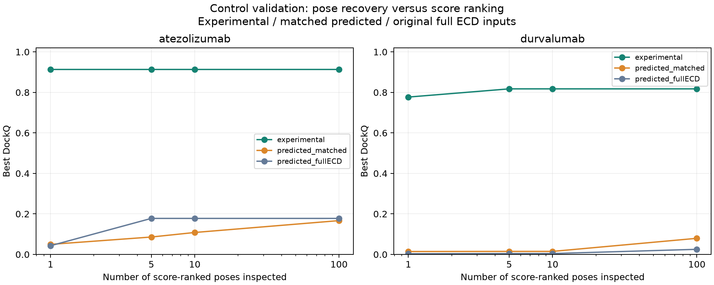

# 대조군 도킹 검증 — 2026-11-19

기존 MAGE 20쌍·LoRA 20쌍·대조군 2쌍의 main 계산은 **42/42 완료** 상태로 보존한다. 아래는 도킹 방법을 점검하기 위한 별도 실험이며, 생성 모델의 성능 검증과 구분한다.

## 비교 조건

- **experimental:** atezolizumab(5X8L)·durvalumab(5X8M) 실험 복합체에서 분리한 Fv와 PD-L1의 재도킹.
- **predicted_matched:** 동일 대조군의 기존 ColabFold 좌표를 실험 구조에서 관측된 잔기 범위로 자른 입력. 실험 좌표를 예측 입력에 섞지 않는다.
- **predicted_fullECD:** 기존 main 대조군 결과를 재사용한다. 항원 범위가 다르므로 위 두 조건과 별도로 해석한다.

새 계산은 두 대조군 × 두 입력 조건, **총 4개를 순차 실행**한다. 각 조건은 CPU 6개 병렬, seed 42, 초기 탐색 1,000개·정제 100개이다. 정답 결합면은 탐색 제약으로 사용하지 않고, 기존과 같은 CDR/접근성 정책을 적용한다.

**완료: 2026년 11월 20일 02:49 KST.** 신규 재도킹 4/4조건 및 기존 main 대조군을 포함한 6조건·600포즈 평가를 마쳤다. 현재 계산은 종료됐으며 기존 main 42쌍도 보존돼 있다. `status_snapshot.json`은 최종 확인 시점의 스냅샷이다.

## 평가와 출력

`구조평가.py validate-controls`가 완료 조건을 재사용하며 진행한다. 최소화된 전체 100개 포즈에 HADDOCK 공식 CAPRI 평가를 적용한다.

- DockQ, Fnat(중원자 5 Å 접촉), iRMSD(10 Å 기준 인터페이스), LRMSD.
- 점수 상위 1/5/10개에서 찾은 최상 DockQ와 전체 100개에서의 최상 DockQ를 구분한다.
- 실제 선택된 최상 클러스터 상위 4개도 따로 기록한다. 전체에서 정답과 가장 비슷한 포즈를 고르는 값은 진단용이며 실제 선별 성능과 다르다.
- H/L을 전역 잔기 번호를 유지한 하나의 B 체인으로 취급해 항체 내부 H–L 접촉이 Fnat에 포함되지 않도록 한다.
- 비교 JSON과 정적 PNG/SVG를 자동 생성한다. 결과 위치는 기존 결과 루트의 `control_validation/`이다. 최종 결과를 이 공유 폴더에 반영했다.

## 완료 결과와 읽는 방법

- 실험 구조 입력의 전체 100개 중 최상 DockQ: atezolizumab **0.9128**, durvalumab **0.8174**.
- 잔기 범위 일치 ColabFold 입력: 각각 **0.1669**, **0.0795**.
- 기존 전체 ECD 입력: 각각 **0.1778**, **0.0251**.
- 실험 atezolizumab의 `emref_2.pdb`는 점수 1위(-154.3448), DockQ 0.9128이지만 FCC 결과의 cluster_id가 `-`여서 최종 클러스터 선택에서 제외됐다. 최상 클러스터 상위 4개의 최상 DockQ는 0.0206이었다. 이 사례에서 개별 포즈 점수는 좋은 포즈를 1위로 올렸으나 클러스터 필터가 이를 보존하지 못했다.
- 위 최상값은 정답을 보고 찾은 진단용 값이다. 실제 선별 성능은 점수 상위 1/5/10과 선택 클러스터 상위 4개 값을 함께 확인해야 한다.

- `quality_summary.csv`: 6조건의 점수 순위별 DockQ 및 최종 선택 클러스터 품질 요약.
- `comparison.json`, `quality/`: 600개 포즈의 점수·DockQ·Fnat·RMSD와 해시 기록.
- `docking_analysis/`: 신규 4조건의 대표 클러스터 포즈 PDB, 접촉면·PRODIGY 지표 및 PyMOL 표시 파일. 전체에서 정답과 가장 비슷한 포즈와 다를 수 있다.
- `control_validation.svg`: 발표/보고서용 벡터 그림.

[후속 계획](../../구조평가_환경/대조군검증_후속계획.md): 기존 좌표로 선정 방식 점검 → 구조 정렬·입력 차이 감사 → 필요 시 동일 제약/서열을 통제한 소규모 교차 실험. 현재는 계획만 저장했으며 추가 계산은 시작하지 않았다.

## 해석 한계

두 실험 항원의 서열 위치 29는 GLU이고 예측 입력은 GLN이다. 잔기 범위가 같아도 서열이 완전히 동일하지 않으므로 차이를 구조 오차 하나로만 귀속하지 않는다. 각 입력의 접근성으로 정해지는 제약 잔기도 달라질 수 있다.

결합 상태에서 추출한 실험 구조를 사용하는 재도킹은 유리한 조건이다. 이 조건에서 성공해도 실제 생성 항체의 결합이나 LoRA의 우수성을 입증하지 않는다. 단일 시드 실험이며 통계적인 성공률 추정이 아니다.

기존 4 Å 잔기 접촉 recall과 CAPRI의 5 Å Fnat은 서로 다른 지표이다. 동일 구조는 DockQ≈1, 항체만 멀리 이동시킨 구조는 Fnat=0·낮은 DockQ가 나오는 검사와 예측 좌표 보존 검사를 통과했다.
