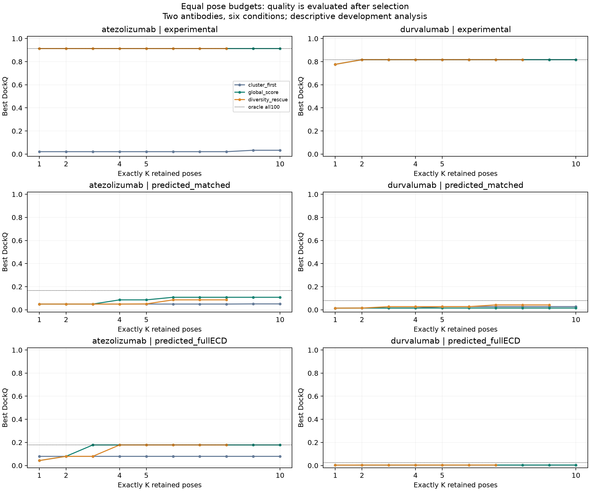
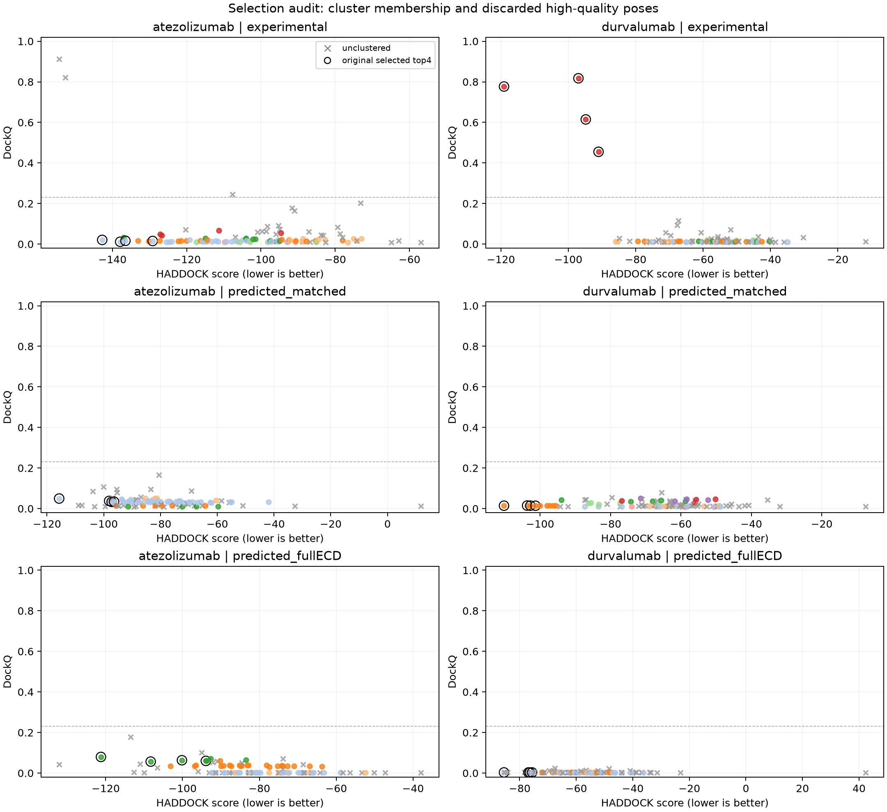
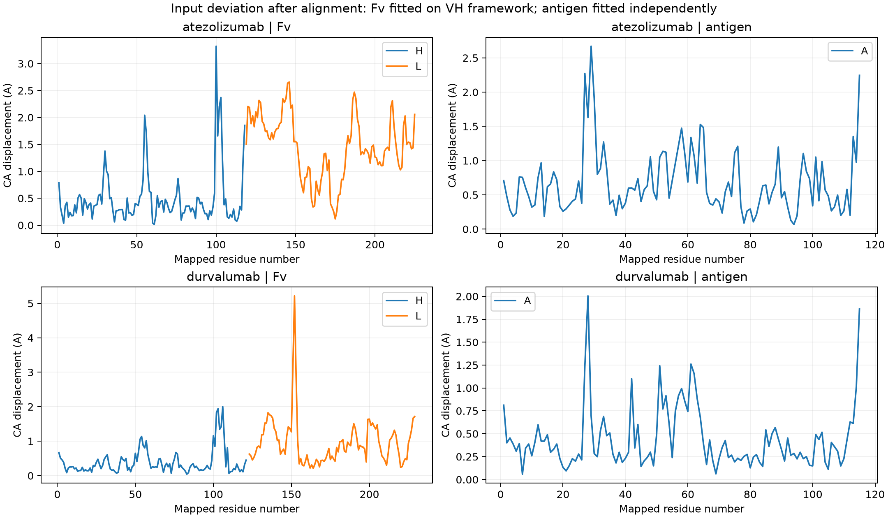
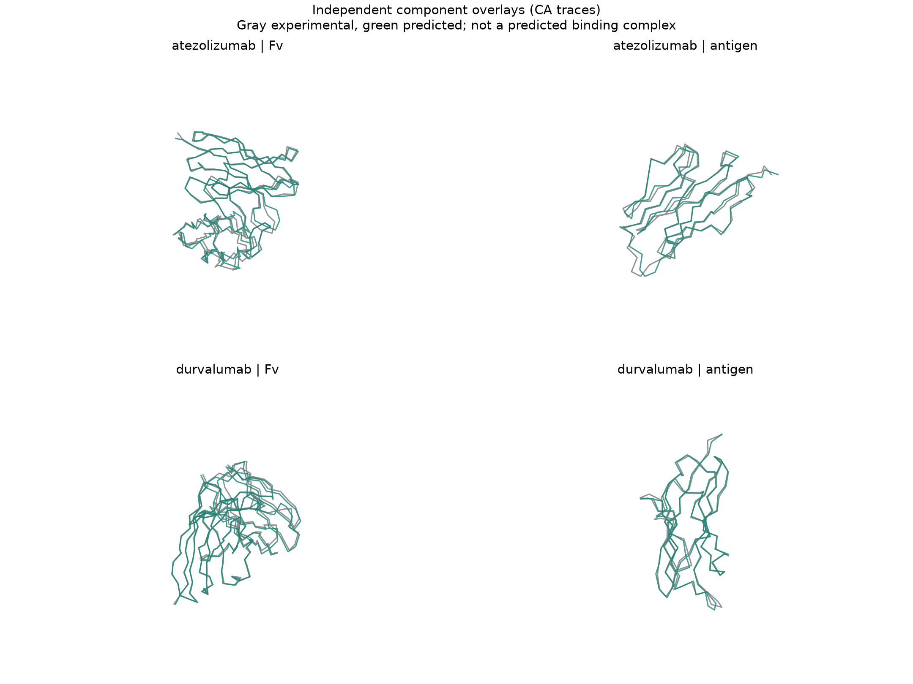

# 대조군 선정 방식·입력 구조 점검 — 2026-11-20

승인된 후속 계획 **1·2단계 완료**. 기존 6조건의 정제·최소화 포즈 **600개**와 입력 구조를 재사용했다. 새 도킹·구조 예측·새 seed 반복·재클러스터링은 실행하지 않았다. 기존 main42와 검증 결과는 그대로 보존했다. 3단계 교차 실험은 아직 시작하지 않았다.

## 1. 선정 방식: 같은 4개를 남겨도 결과가 달랐다

- 실험 atezolizumab: 기존 최상 클러스터 4개의 최상 DockQ는 **0.0206**, 전체 점수 상위 4개는 **0.9128**, 다양성+구제 규칙의 처음 4개도 **0.9128**이었다. 정답 DockQ는 선정에 사용하지 않고 평가에만 사용했다.
- 실험 durvalumab: 세 규칙 모두 같은 4개 예산에서 최상 DockQ **0.8174**를 보존했다. 그러나 전체에서 DockQ≥0.23인 4개 중 회수한 수는 기존/전체점수 4개, 다양성+구제 3개였다. 최상값이 같다고 포즈 회수율까지 동일하거나 구제 규칙이 항상 우수한 것은 아니다.
- atezolizumab의 점수 1위 `emref_2.pdb`는 미분류 포즈였다. 저장된 FCC 행렬에 원래 cutoff0.6/strictness0.75를 적용하면 이 포즈의 이웃은 `emref_1.pdb` 하나다. 자신을 포함한 이웃 수 2는 최소 클러스터 인원 4보다 작다. 이는 저장된 반올림 행렬의 진단이며 새 클러스터링 결과가 아니다. 미분류를 모두 단일 포즈라고 부르지 않는다.
- 예측 입력 4조건에서는 정제·최소화된 100개 중에도 DockQ≥0.23인 포즈가 없었다. 선정 방식만 바꿔 해당 집합에 없는 좋은 자세를 만들 수는 없다. 초기 rigidbody 1,000개의 전체 품질이나 정제 전 선정 손실까지 검사한 것은 아니다.

고정 비교 규칙은 최상 클러스터 상위4, 전체 점수 상위5, 상위5 클러스터 대표와 점수 상위5의 합집합(중복 제거)이다. 서로 크기가 다른 고정 집합의 결과는 따로 저장했다. 공정한 후보 수 비교는 `equal_budget.csv`의 **selected_n=K**인 행을 사용한다. `cluster_first`는 K>4에서 기존 최상 클러스터 규칙을 다음 클러스터까지 확장한 순서이다. 다양성+구제 순서는 전체점수와 클러스터 대표를 번갈아 추가하며, DockQ를 보지 않는다.

## 2. 구조: 전체 framework는 비슷하지만 국소 차이가 있었다

공통 관측 backbone 원자 N/CA/C/O를 사용했다. 각 사슬 framework에 맞춘 뒤 CDR RMSD를 계산해 loop의 차이가 loop 자체 정렬로 가려지지 않게 했다.

- atezolizumab: VH framework **0.443 Å**, VL framework **0.427 Å**, CDR-H3 **1.637 Å**. VH framework에 정렬한 뒤 VL 전체 backbone의 차이는 **1.561 Å**였다. VL을 독립적으로 정렬한 backbone RMSD는 **0.431 Å**이므로 상대 배치 차이를 함께 살펴볼 필요가 있다.
- durvalumab: VH framework **0.357 Å**, VL framework **0.452 Å**, CDR-L1 **2.220 Å**, CDR-H3 **1.225 Å**. VH 정렬 뒤 VL 차이는 **1.152 Å**였다.
- PD-L1 backbone 자기 정렬 RMSD는 각각 **0.865/0.599 Å**. 기준 복합체의 4 Å 접촉 잔기로 정의한 항원 결합면 backbone 차이는 **1.066/0.398 Å**였다.
- 높은 pLDDT와 작은 backbone 차이만으로 도킹 자세의 정확성을 보장할 수 없다. 예를 들어 durvalumab의 CDR-L1 평균 pLDDT는 약95.47이지만, framework 정렬 후 차이는 2.220 Å였다.
- 결합 상태 실험 구조와 분리 상태 예측 구조의 차이에는 구조 예측 오차뿐 아니라 상태·유연성·유도 적합의 영향도 있을 수 있다. RMSD만으로 이를 구분하지 않는다. side-chain RMSD는 동일 아미노산의 공통 원자만 비교했고 대칭 원자 이름 교환을 보정하지 않았으므로 보조 지표이다.

위 중첩은 **Fv와 항원을 각각 정렬한 그림이며 예측 결합 복합체가 아니다.** `structures/<대조군>/view.pml`은 해당 폴더를 작업 디렉터리로 설정해 실행한다. Fv/antigen을 별도 scene으로 보여준다.

## 3. 구조 외 혼동 요인도 실제로 확인했다

- 두 대조군 모두 항원 서열 위치29가 실험 입력 **GLU**, 예측 입력 **GLN**이다.
- 실제 접근성 제약 잔기도 달랐다. atezolizumab 항원 접근성 잔기 집합의 Jaccard는 **0.695**, VH CDR 제약은 **0.692**였다. durvalumab은 각각 **0.833/0.769**였다. 같은 제약 생성 정책이 동일한 제약 집합을 뜻하지 않는다.
- 처리된 CNS PSF의 원자 종류·잔기 이름·부분전하를 비교했다. 비원자 종료행(id=-1)을 제외한 PSF 원자 수와 PDB 원자 수가 일치하는지 검사했고, 원본 PSF 해시를 저장했다.
- atezolizumab은 전처리 후 heavy2627/H897로 두 입력의 원자 수가 같지만, **VH 서열100 및 VL 서열94(현재 전역 파일 번호 H100/L212)**의 히스티딘 화학 타입·양성자화 상태가 달랐다. 두 잔기의 모델상 전하는 각각 실험 +1e, 예측 0e였다. 항원 위치29는 실험 -1e/예측0e이다. 전체 처리 분자의 부분전하 합은 실험 +2e/예측+1e였다. 단순 원자 수 비교는 이 차이를 감췄다.
- durvalumab에서는 원자/화학 타입/전하 차이가 항원 위치29에 국한됐다. 수소 수는 실험928/예측930이고, 전체 모델상 전하 합은 +1e/+2e였다.
- 이 전하는 force field 전처리로 부여된 값이며 생리적 조건의 실제 양성자화 상태를 측정한 결과가 아니다. 전하 차이가 도킹 실패의 원인이라고 확정하지 않는다.

## 다음 판단

**선정 단계에서는 고득점 미분류 포즈를 버리지 않고 별도 후보로 보존하는 방식이 우선 검토 대상이다.** 미분류 포즈의 낮은 수렴도 표시는 유지해야 한다. 두 대조군을 이용한 개발 결과이므로 독립 검증 없이 전체 생성 모델 성능 개선이라고 발표하지 않는다.

입력 영향을 분리하는 3단계에서는 공통 항원·서열·AIR 잔기 집합뿐 아니라 **양성자화/화학 타입 설정도 동일하게 통제**해야 한다. 추가 도킹은 해당 조건을 고정한 대조군 교차 실험부터 시작하며, 현재는 실행하지 않았다. 생성 항체 40쌍의 순위나 v1 결과도 변경하지 않았다.

## 파일·재실행

- `audit.json`: 전체 분석·출처 해시·규칙·구조/전처리 상세.
- `pose_trace.csv`: 600개 포즈의 점수·DockQ·클러스터·선정 여부.
- `selection_rules.csv`: 고정된 세 후보 집합 비교(집합 크기가 다를 수 있음).
- `equal_budget.csv`: 후보 수 K를 정확히 맞춘 비교. 전체에 허용 품질 포즈가 없으면 회수율은 null이며 0으로 대체하지 않는다.
- `structure_metrics.csv`, `structures/*/structure_audit.json`: framework/CDR/상대 배치/항원 차이, AIR·원자·신뢰도 자료.
- `structures/*/processed_atoms.csv`: 실제 처리된 각 원자의 잔기·화학 타입·부분전하.
- PNG/SVG 4종과 독립 정렬 PDB·PyMOL scene.

WSL 구조 환경에서 `python 구조평가.py audit-controls`로 기존 파일만 재분석한다. 검사 `검사/test_control_audit.py`와 `검사/test_control_validation.py`의 6개 검사를 통과했다.

DockQ≥0.23은 [DockQ 공식 품질 구분](https://github.com/wallnerlab/DockQ)에 따른 진단 기준이다. 여섯 조건은 독립 항체 여섯 개가 아니며, 통계적 유의성이나 실제 결합 친화도 향상을 주장하지 않는다.
